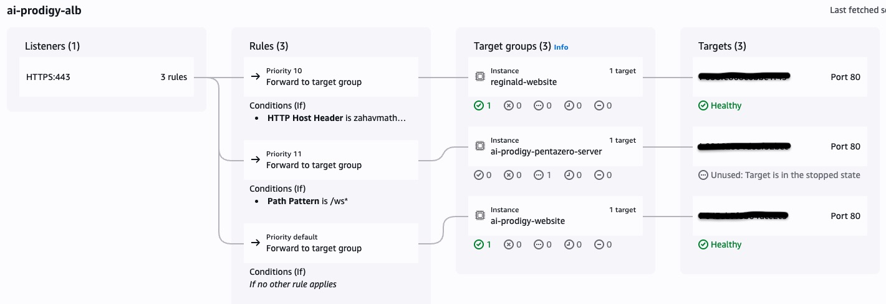
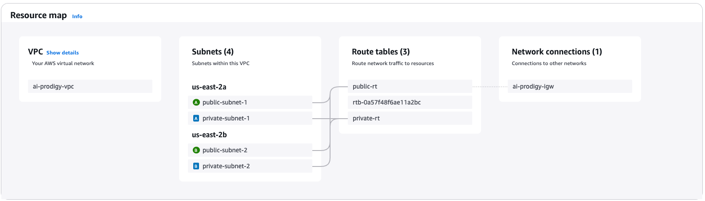

# AI Prodigy – Production AWS Architecture (2025)

This is the EC2-based architecture that ran AI Prodigy's website and real-time translation service in 2025.
See [How it evolved](#how-it-evolved) for what replaced it.

## Highlights
| Component | Description |
|-----------|-------------|
| VPC (2 AZ) | 2 public + 2 private subnets |
| ALB        | One HTTPS listener: a host-header rule for a second hosted site, `/ws*` to the WebSocket translation server, and a default rule to the website |
| NAT Instance | Replaces NAT Gateway to reduce cost |
| VPC Endpoints | Private access to ECR, S3, Secrets Manager, and SSM |
| RDS Postgres | Encrypted, used for user/session data |
| EC2 Auto Scaling | Hosts Dockerized app containers |

## Cost Optimization

We replaced a managed NAT Gateway (~$0.045/hr) with a `t3.micro` EC2 NAT instance (~$0.01/hr) + interface VPC endpoints for ECR, Secrets Manager, and SSM, resulting in:

- Monthly networking cost savings of ~**40%**
- Faster pull times from ECR
- No impact on uptime

## Uptime

Zero downtime achieved using:
  - **Multi-AZ ALB** distributing traffic across private-subnet EC2 instances.
  - **Rolling updates via Auto Scaling:** each new instance boots with a cloud-init **user-data script** that
    1. pulls the correct Docker image from ECR,
    2. starts the container with a container-level health check,
    3. receives traffic only after passing the ALB target group health check.
  - The ALB deregistration delay drains connections from old instances before they terminate, so no open
    connections are dropped.
  - Auto Scaling automatically replaces any unhealthy instance to keep
    capacity steady without manual intervention.

## ALB Resource Map

## VPC Resource Map

## How it evolved

| When | Change |
|------|--------|
| Jun 2025 | Releases automated with GitHub Actions → ECR → AWS CodeDeploy blue/green on EC2 |
| Oct 2025 | Website migrated to **ECS Fargate**, with the infrastructure defined in **Terraform** (network, ALB, ECR, IAM, ECS service, and logging modules; S3 + DynamoDB remote state) |
| Mar 2026 | Website moved to a **serverless** Terraform stack (CloudFront, API Gateway, Lambda, DynamoDB, Cognito), deployed by GitHub Actions running `terraform plan` / `apply` |
